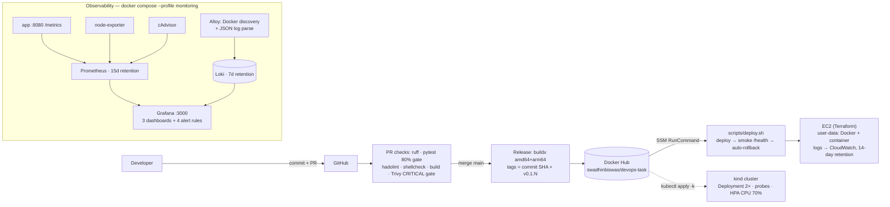

# DevOps task: FastAPI service, end to end

A small FastAPI service with a hardened container image, CI/CD with security gates, Terraform for the AWS side, Kubernetes manifests, a Grafana/Prometheus/Loki stack, and a host health script. Every command in this README was run on my machine; the evidence files hold the real outputs.

The final image is 84 MB, 10 tests cover 94% of the app code, and every commit is signed.

## Repository layout

| Path | What it is |
|---|---|
| [`app/`](app/) | Application code: [`main.py`](app/main.py) (routes), [`config.py`](app/config.py), [`logging.py`](app/logging.py), [`metrics.py`](app/metrics.py) |
| [`tests/`](tests/) | pytest suite (10 tests) |
| [`Dockerfile`](Dockerfile) | Multi-stage build: Alpine 3.23, non-root UID 10001 |
| [`docker-compose.yml`](docker-compose.yml) | The app plus the `monitoring` profile |
| [`monitoring/prometheus/prometheus.yml`](monitoring/prometheus/prometheus.yml) | Scrape config; alert rules in [`alerts.yml`](monitoring/prometheus/alerts.yml) |
| [`monitoring/loki/loki-config.yml`](monitoring/loki/loki-config.yml) | Loki config, 168h retention |
| [`monitoring/alloy/config.alloy`](monitoring/alloy/config.alloy) | Docker container discovery and JSON log parsing |
| [`monitoring/grafana/`](monitoring/grafana/) | Provisioned datasources and the three dashboards: [`application`](monitoring/grafana/dashboards/application.json), [`host`](monitoring/grafana/dashboards/host.json), [`containers`](monitoring/grafana/dashboards/containers.json) |
| [`k8s/`](k8s/) | Deployment, Service, Ingress, ConfigMap, HPA, [`secret.example.yaml`](k8s/secret.example.yaml) |
| [`terraform/`](terraform/) | [`bootstrap/`](terraform/bootstrap/main.tf) (state bucket, OIDC role, ECR), shared [`modules/app-runtime/`](terraform/modules/app-runtime/main.tf), [`envs/staging/`](terraform/envs/staging/main.tf), [`envs/production/`](terraform/envs/production/main.tf) |
| [`scripts/system_health.sh`](scripts/system_health.sh) | Host health probe (task step 6) |
| [`scripts/systemd/system-health.timer`](scripts/systemd/system-health.timer) | Timer, with its [`service`](scripts/systemd/system-health.service), to run the probe every 5 minutes |
| [`scripts/deploy.sh`](scripts/deploy.sh) | EC2 deploy and rollback over SSM |
| [`scripts/ci-check.sh`](scripts/ci-check.sh) | The CI checks, runnable locally |
| [`.github/workflows/pr.yml`](.github/workflows/pr.yml) and [`release.yml`](.github/workflows/release.yml) | PR gates and the release/deploy pipeline |
| [`.circleci/config.yml`](.circleci/config.yml), [`.buildkite/pipeline.yml`](.buildkite/pipeline.yml) | Fallback pipelines running the same checks |
| [`Makefile`](Makefile) | lint, test, build targets |
| [`pyproject.toml`](pyproject.toml), [`uv.lock`](uv.lock) | Dependencies, locked |
| [`.env.example`](.env.example) | Template for `.env` (copy it, fill in the Grafana credentials) |
| [`docs/evidence/`](docs/evidence/) | Proof for each task step (table under Evidence) |
| [`docs/images/`](docs/images/) | Dashboard and alert screenshots |

## Architecture



The same image deploys two ways: to EC2 (Terraform provisions the instance, SSM runs the deploy, logs go to CloudWatch) and to a local kind cluster (manifests only). Prometheus scrapes the app, node-exporter, and cAdvisor; Alloy ships parsed container logs to Loki; Grafana reads both.

## Prerequisites

| Tool | Needed for | Tested with |
|---|---|---|
| Docker + Compose v2 | app + observability stack | Docker 29, Compose 5.7 |
| [uv](https://docs.astral.sh/uv/) (Python 3.12) | tests, local app run | uv 0.9 |
| kind + kubectl | Kubernetes step | kind v0.30 |
| Terraform + AWS CLI | cloud steps | TF 1.14, AWS CLI 2 |

## Quick start

### 1. Run the app

```bash
cp .env.example .env          # APP_PORT/APP_ENV/LOG_LEVEL/APP_VERSION
docker compose up -d --build
curl -s http://127.0.0.1:8080/
curl -s http://127.0.0.1:8080/health
docker compose logs -f app    # JSON logs on stdout
```

`GET /` returns exactly `{"message":"Hello from DevOps Task!","status":"running","version":"0.1.0"}`.

### 2. Run the observability stack

```bash
# .env must contain GF_SECURITY_ADMIN_USER and GF_SECURITY_ADMIN_PASSWORD
docker compose --profile monitoring up -d
docker compose --profile monitoring ps
```

Open Grafana at `http://127.0.0.1:3000` and sign in with the `GF_SECURITY_ADMIN_*` values from `.env`. There is no external Grafana account: the admin user is created from `.env` on first start, and Compose refuses to start Grafana if the variables are missing. Data sources (Prometheus, Loki) and all three dashboards are provisioned from files under `monitoring/`, so nothing is configured by hand in the UI:

| Dashboard | Panels |
|---|---|
| Application (`devops-task-application`) | request rate, 5xx error ratio, latency p50/p95/p99, Loki log panel |
| Host (`devops-task-host`) | CPU, memory, disk, network (Node Exporter) |
| Containers (`devops-task-containers`) | per-container CPU, memory, memory vs limit (cAdvisor) |


Prometheus keeps 15 days (`--storage.tsdb.retention.time=15d`); Loki keeps 7 days (`retention_period: 168h`). Only Grafana publishes a host port (127.0.0.1:3000); everything else talks over the internal `monitoring` network. Grafana joins both networks because this Docker daemon does not publish ports for containers on an internal-only network. Image versions are pinned; cAdvisor is `0.54.0` with `--docker_only=true`, the build that resolves container names on Docker 29 / containerd-snapshotter hosts (0.56.x panics there).

### 3. Run the tests

```bash
uv sync --frozen
uv run pytest --cov=app --cov-report=term-missing   # 10 tests, 94% coverage
uv run ruff check .
make ci                                             # lint + tests + build + Trivy
```

### 4. Run the health script

`scripts/system_health.sh` collects CPU, memory, disk usage for all mounted filesystems, load average, and the top 5 processes by memory; appends a timestamped entry to `health_log.txt` (or `--json` for JSONL); prints `[WARNING]`/`[CRITICAL]` on stderr; and exits `0` healthy / `1` warning / `2` critical / `3` usage error.

```bash
./scripts/system_health.sh                       # one-shot, defaults: --disk 80 --cpu 90 --mem 85
./scripts/system_health.sh --json --disk 70      # JSONL entry, lower disk threshold
./scripts/system_health.sh --help                # all flags, defaults, cron example
```

Log rotation is built in: when the log reaches 1 MiB it shifts to `health_log.txt.1/.2/.3` (sizes and count tunable via `HEALTH_LOG_MAX_BYTES` / `HEALTH_LOG_KEEP`). To run it every 5 minutes, install the systemd units from `scripts/systemd/`:

```bash
sudo cp scripts/system_health.sh /usr/local/bin/
sudo cp scripts/systemd/system-health.{service,timer} /etc/systemd/system/
sudo systemctl daemon-reload && sudo systemctl enable --now system-health.timer
```

A cron alternative (`*/5 * * * *`) is in `--help`. The timer is the monitoring integration point: exit 1/2 mark the unit failed for `systemctl --failed` or a watchdog.

### 5. Terraform (EC2 + CloudWatch + S3 state)

```bash
cd terraform/bootstrap           # S3 state bucket, GitHub OIDC role, ECR (local state)
cp terraform.tfvars.example terraform.tfvars
terraform init && terraform apply

cd ../envs/staging
terraform init
terraform validate
terraform plan -var-file=staging.tfvars
terraform apply -var-file=staging.tfvars
curl -s http://$(terraform output -raw public_ip):8080/health
aws logs tail $(terraform output -raw log_group_name) --follow
terraform destroy -var-file=staging.tfvars   # after evidence is captured
```

`terraform/envs/staging` and `envs/production` share `terraform/modules/app-runtime` (EC2, security group with only port 8080, least-privilege IAM role, CloudWatch log group with 14-day retention) with separate S3-locked state. Production is planned but not applied: `terraform -chdir=terraform/envs/production plan -var-file=production.tfvars`. The instance boots from user data (Docker install, pull, run) and retries until IMDS credentials appear. No SSH: SSM only, no key pair, no port 22.

If the account already has the GitHub OIDC provider, import it first:

```bash
terraform import aws_iam_openid_connect_provider.github \
  arn:aws:iam::<account-id>:oidc-provider/token.actions.githubusercontent.com
```

### 6. Kubernetes (kind)

```bash
kind create cluster --name devops-task
kubectl create secret generic devops-task-secret \
  --from-literal=APP_ENV=staging \
  --from-literal=LOG_LEVEL=INFO
kubectl apply -k k8s/
kubectl rollout status deployment/devops-task
kubectl get pods,svc,hpa
kubectl port-forward svc/devops-task 8080:80
curl -s localhost:8080/health
```

Only [`k8s/secret.example.yaml`](k8s/secret.example.yaml) is committed; the real Secret is created in the cluster. 2 replicas, `maxUnavailable: 0`, liveness/readiness/startup probes on `/health`, requests `100m/64Mi`, limits `500m/256Mi`, UID 10001, read-only root filesystem, all capabilities dropped, HPA on CPU 70% (min 2, max 5). Zero-downtime update and rollback, proven with a 900-request loop against the Service (900/900 HTTP 200; `preStop: sleep 15` drains terminating pods):

```bash
kubectl set image deployment/devops-task app=swadhinbiswas/devops-task:v0.1.8
kubectl rollout status deployment/devops-task
kubectl rollout undo deployment/devops-task     # back to the previous revision
```

For EKS: AWS Load Balancer Controller with ACM TLS instead of ingress-nginx, External Secrets Operator + Secrets Manager instead of a generated Secret, Karpenter or Cluster Autoscaler for nodes, IRSA / Pod Identity instead of instance roles, and managed Prometheus/Grafana or kube-prometheus-stack with remote storage.

## CI/CD

Pull requests run ruff, pytest with an 80% coverage gate and a job-summary report, hadolint, shellcheck, an image build, and a Trivy scan that fails on CRITICAL findings. GitGuardian scans every push for leaked secrets.

Pushes to `main` build `linux/amd64` and `linux/arm64` images with GitHub Actions layer caching. Images are tagged with the full commit SHA and `v0.1.<run-number>`; `latest` is never used. The release logs in to Docker Hub, pushes, syncs `scripts/deploy.sh` to the instance over SSM, deploys, and smoke tests `/health`. If the deploy or smoke test fails, `scripts/deploy.sh --rollback` restores the previous image tag.

Repository configuration (in GitHub under Settings → Secrets and variables → Actions):

| Type | Name | Purpose |
|---|---|---|
| Variable | `AWS_REGION` | `ap-southeast-1` |
| Variable | `AWS_ROLE_ARN` | OIDC deploy role from `terraform output` |
| Variable | `DOCKERHUB_USERNAME` | Docker Hub account |
| Variable | `EC2_INSTANCE_ID` | `i-...` target instance |
| Secret | `DOCKER_HUB_KEY` | Docker Hub token (Read & Write) |

No AWS access keys exist anywhere. AWS calls assume the deploy role through GitHub OIDC; the instance pulls the public image anonymously, so no registry credential sits on the host either.

### Fallback checks

GitHub Actions is the primary pipeline; the same checks run locally with `make ci` or `./scripts/ci-check.sh --no-docker`. `.circleci/config.yml` mirrors the PR job for CircleCI; `.buildkite/pipeline.yml` runs the same checks and, on `main`, `scripts/buildkite-release.sh` on a self-hosted agent. The GitHub PR jobs run on a repository-scoped self-hosted runner restricted to branches in this repository; fork pull requests are skipped so untrusted code never runs on it.

## Deployment & rollback strategy

1. Build once, promote by tag. `main` merges produce exactly one multi-arch image, tagged with the commit SHA and `v0.1.N`. Environments never build their own image, so what CI tested is what runs.
2. Deploy atomically. The release job sends `scripts/deploy.sh <tag>` over SSM. The script records the currently running tag, pulls the new one, swaps the container, and waits for `/health` to answer.
3. Smoke before calling it done. `/health` must return 200 within the smoke window; anything else is a failed deploy.
4. Roll back automatically. On any deploy or smoke failure the script redeploys the previous tag (the `--rollback` path) and exits non-zero so the workflow fails visibly. Proven live by deploying a deliberately bogus tag (`hello-world:9.9.9-bogus`) and watching the rollback restore the real service: [step2-rollback.md](docs/evidence/step2-rollback.md).
5. On Kubernetes, `kubectl set image` plus `rollout status`, with `maxUnavailable: 0` so capacity never drops; `kubectl rollout undo` returns to the previous ReplicaSet revision (demonstrated, 900/900).
6. The service is stateless (no database schema), so image-level rollback is complete and there is no data migration to undo.

## Security considerations

- Secrets management: no secrets in the repo or CI logs. AWS access uses GitHub OIDC (no static keys), the Docker Hub token lives only in the Actions secret store, Grafana credentials come from `.env` (gitignored, with a fail-closed entrypoint), and the Kubernetes Secret is created at apply time (only an example file is committed). GitGuardian and GitHub secret scanning run on every PR.
- Image supply chain: base images are pinned to specific versions, and CI fails the build on Trivy CRITICAL findings; hadolint gates Dockerfile hygiene.
- IAM: the GitHub Actions deploy role is trusted only for this repo and `main`; the EC2 instance profile is scoped to ECR pull and CloudWatch Logs write. No static access keys anywhere, no SSH key pair on the instance (SSM Session Manager only).
- Network exposure: the security group opens only 8080, the app binds 127.0.0.1 locally, and in the monitoring stack only Grafana is published (on loopback) while everything else stays on the internal Docker network.
- Runtime hardening: containers run as UID 10001 with read-only root filesystems, all capabilities dropped, `no-new-privileges`, and resource limits; the Kubernetes `securityContext` mirrors this. cAdvisor and Node Exporter mount host paths read-only only (see the observability section above).

## Design decisions

| Decision | Choice | Why |
|---|---|---|
| Final image | Alpine 3.23, pinned; shell + `apk` removed | 84 MB vs ~250 MB python:slim; keeps `python3` for the container `HEALTHCHECK`. Distroless would drop the shell entirely, making the healthcheck exec-only and incident debugging harder; the app is Python, so a Python base is required anyway. |
| Compute | EC2 + SSM over ECS/EKS | One stateless service: EC2 is the cheapest production-ready target, ECS adds scheduling value only at multi-service scale, EKS costs ~$73/mo control plane before nodes. K8s competency is demonstrated on kind without paying for it. |
| Registry | Docker Hub (public) | The EC2 instance pulls anonymously, so no registry credentials sit on the host and the deploy path needs no ECR login. ECR remains available in bootstrap for private-mode deployments. |
| Tagging | SHA + `v0.1.N`, never `latest` | Every deploy and rollback names an immutable tag; `latest` would make rollback nondeterministic. |
| Deploy channel | SSM Run Command | No inbound SSH surface, no key management; the instance role already allows `ssm:SendCommand` scoped to itself. |
| Log labels | `level` + `path` only | Both are low-cardinality: a few levels, bounded route templates. Request IDs and raw URLs stay in the line body; indexing them would explode Loki's stream count with traffic. |
| Prometheus retention | 15d | Local filesystem store; 15 days is enough to see weekly patterns without unbounded disk growth. Loki: 7d. |
| Alert thresholds | See table in Monitoring | Each `for` duration tolerates transient spikes; reasoning inline. |

## AWS cost estimate (production, ap-southeast-1, on-demand)

| Item | Spec | Monthly |
|---|---|---|
| EC2 t3.micro | 2 vCPU / 1 GB, 24/7 | ~$7.60 |
| EBS gp3 root volume | 8 GB | ~$0.72 |
| EBS snapshots | 1 × 8 GB | ~$0.80 |
| CloudWatch Logs | ~1 GB ingest, 14-day retention | ~$0.70 |
| S3 (Terraform state + versions) | < 1 GB | ~$0.05 |
| Data transfer out | few GB (image pulls are inbound/free) | ~$0.25 |
| **Total** | single instance | **~$10/month** |

t3.small (2 GB) if the app needs headroom: about $15.2 plus storage, call it $18/month. The EKS path would add a ~$73 control plane and two t3.small nodes (~$30), so $103+/month before load balancers; that is why EC2 was chosen for this scope.

## What I would improve with more time

- Alert routing: Alertmanager (or Grafana Alerting) with Slack/PagerDuty receivers, silences, and dedup. The four rules currently have no notification channel.
- Staging environment in CI: deploy to a staging instance on PR merge, run an integration smoke suite, then promote the same tag to production.
- SLO burn-rate alerts on top of the static thresholds, with multi-window paging instead of single-metric trips.
- Loki on object storage (S3 backend) so retention and restarts don't depend on one node's disk.
- E2E tests (testcontainers) and a k6 load profile in CI, to catch latency regressions the unit tests can't.
- Dependency automation: Renovate for base images and Python dependencies, with a Trivy re-scan per bump.
- HA for the EC2 path: two instances behind an ALB in an ASG, or ECS with blue/green deploys.
- Containerd-native container metrics: this workstation runs Docker 29's containerd snapshotter; cAdvisor 0.54 works, but a containerd-native exporter would age better.

## AI usage

AI tools helped while building this: scaffolding config files, drafting PromQL and LogQL queries, and debugging. Three concrete examples: removing a deprecated Loki config field, pinning cAdvisor to 0.54.0 for Docker 29, and fixing a `/proc/stat` parsing bug in `system_health.sh` that made every run report 100% CPU. I reviewed and ran everything myself; the evidence files hold real output from my machine, and I can explain any part of this submission.

## Evidence

Workflow runs: [PR checks](https://github.com/swadhinbiswas/devops-assesment/actions/runs/43019232745), [Release to Docker Hub + EC2](https://github.com/swadhinbiswas/devops-assesment/actions/runs/43033705446), [Release to Terraform instance](https://github.com/swadhinbiswas/devops-assesment/actions/runs/43041045214).

Task-step proof, captured from real runs (all files in [`docs/evidence/`](docs/evidence/)):

| Task step | File | What it proves |
|---|---|---|
| 2 | [`step2-pr-checks.md`](docs/evidence/step2-pr-checks.md) | Lint, tests, coverage, hadolint, shellcheck, build, Trivy gate |
| 2 | [`step2-release.md`](docs/evidence/step2-release.md) | SHA + semver tags, multi-arch manifest |
| 2 | [`step2-rollback.md`](docs/evidence/step2-rollback.md) | Failed deploy rolls back, previous version restored |
| 3 | [`step3-terraform.md`](docs/evidence/step3-terraform.md) | Clean plan, apply outputs, state list, destroy |
| 3 | [`step3-security.md`](docs/evidence/step3-security.md) | SG 8080-only, scoped IAM, no static keys, no key pair |
| 3 | [`step3-cloudwatch-sample.txt`](docs/evidence/step3-cloudwatch-sample.txt) | JSON app logs in CloudWatch, 14-day retention |
| 4 | [`step4-k8s.md`](docs/evidence/step4-k8s.md) | Rolling update 900/900, HPA metrics, rollout undo |
| 5 | [`step5-observability.md`](docs/evidence/step5-observability.md) | Prometheus targets, alert rules, firing proof, Loki parsed labels |
| 6 | [`step6-script.md`](docs/evidence/step6-script.md) | Shellcheck clean, exit codes, JSON, rotation, scheduling units |

Task steps 1 and 7 are the app itself and this README.

Screenshots live in [`docs/images/`](docs/images/): `application-dashboard.png`, `host-dashboard.png`, `containers-dashboard.png`, and `alert-firing.png` (AppInstanceDown firing after the app was stopped for 3 minutes, then restored).

AWS compute was destroyed after testing, as the task asked; the ECR images, Terraform state, and these files remain.

## License

MIT
